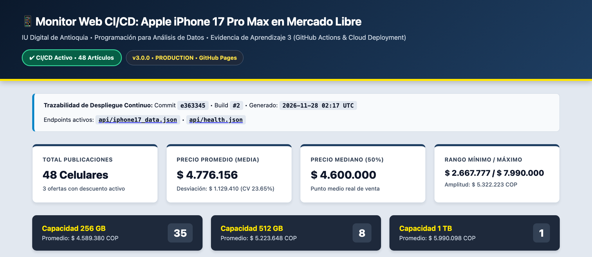
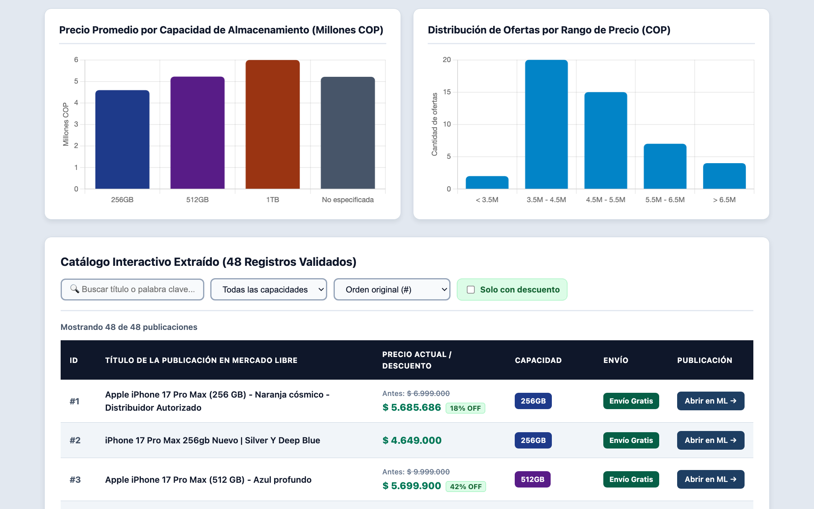
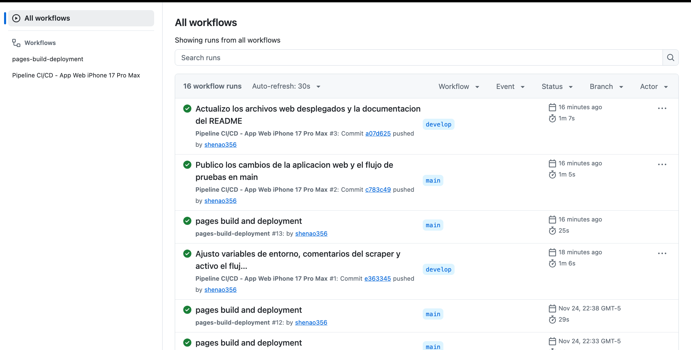
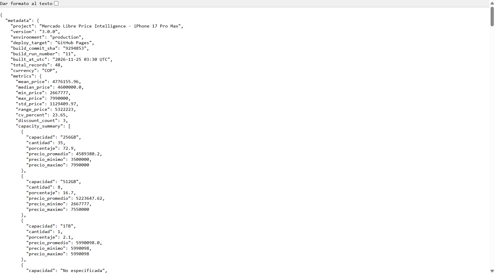

# Monitor Web CI/CD: Apple iPhone 17 Pro Max en Mercado Libre Colombia

[](https://shenao356.github.io/mercadolibre-iphone17pm-shenao/)
[](https://www.python.org/)
[](tests/)
[](#)

Proyecto integrador de las **Evidencias de Aprendizaje 1, 2 y 3 (F35)** de la asignatura **Programación para Análisis de Datos – PREICA2602B020048** (**Institución Universitaria Digital de Antioquia – IU Digital**).

* **Autor:** Raúl Santiago Morales Henao
* **Docente:** Andrés Felipe Palacio
* **Repositorio Oficial:** [https://github.com/shenao356/mercadolibre-iphone17pm-shenao](https://github.com/shenao356/mercadolibre-iphone17pm-shenao)
* **Aplicación Web Desplegada en la Nube (GitHub Pages):** [https://shenao356.github.io/mercadolibre-iphone17pm-shenao/](https://shenao356.github.io/mercadolibre-iphone17pm-shenao/)
* **API JSON en Producción:** [https://shenao356.github.io/mercadolibre-iphone17pm-shenao/api/iphone17_data.json](https://shenao356.github.io/mercadolibre-iphone17pm-shenao/api/iphone17_data.json)
* **Healthcheck en Producción:** [https://shenao356.github.io/mercadolibre-iphone17pm-shenao/api/health.json](https://shenao356.github.io/mercadolibre-iphone17pm-shenao/api/health.json)
* **Ejecuciones de GitHub Actions:** [https://github.com/shenao356/mercadolibre-iphone17pm-shenao/actions](https://github.com/shenao356/mercadolibre-iphone17pm-shenao/actions)

---

## 1. Introducción

Este proyecto consolida la evolución completa de una solución de ingeniería de datos y desarrollo web a lo largo de las tres unidades del curso:

1. **Unidad 1 (EA1 – Extracción de Datos):** Diseño e implementación del extractor web (*Web Scraping*) sobre **Mercado Libre Colombia** para monitorear **48 publicaciones del Apple iPhone 17 Pro Max**, aplicando **BeautifulSoup**, **Selenium WebDriver** y **Scrapy**, con limpieza y exportación a CSV y JSON.
2. **Unidad 2 (EA2 – Control de Versiones y Productividad DevOps):** Estructuración colaborativa con **Git y GitHub** bajo una estrategia de ramificación (`main`, `develop`, `rama-scraper`, `rama-pruebas`, `rama-automatizacion`), Pull Requests auditados, refactorización del selector DOM (`div.poly-price__current` frente a precios tachados `<s>`) y pruebas unitarias iniciales.
3. **Unidad 3 (EA3 / F35 – Optimización de Procesos de Desarrollo y Despliegue en la Nube):** Desarrollo de una **aplicación web interactiva WSGI + API REST (`app.py`)** y un **tablero analítico SPA con gráficas Chart.js (`deploy_dashboard.py` -> `docs/`)**, ampliación de la compuerta de calidad a **14 pruebas automatizadas** (unitarias + integración HTTP), configuración de **variables de entorno**, infraestructura portable (**Docker** y **Render**) y automatización completa del pipeline **CI/CD con GitHub Actions** hacia **GitHub Pages**.

---

## 2. Organización y Estructura del Proyecto

```text
mercadolibre-iphone17pm-shenao/
├── workflows/
│   └── ci_cd_pipeline.yml                  # Definición del pipeline CI/CD de GitHub Actions (3 etapas)
├── docs/                                   # Paquete web de producción servido por GitHub Pages
│   ├── .nojekyll                           # Desactiva Jekyll para servir recursos estáticos directo
│   ├── index.html                          # Aplicación Web SPA (KPIs, Chart.js, filtros, tabla)
│   ├── api/
│   │   ├── iphone17_data.json              # API JSON estática con métricas y 48 registros
│   │   └── health.json                     # Endpoint estático de estado y trazabilidad CI/CD
│   └── screenshots/                        # Capturas de pantalla que evidencian el despliegue real
├── tests/
│   ├── test_scraper.py                     # 6 pruebas unitarias del scraper DOM, precios y datasets
│   └── test_webapp.py                      # 8 pruebas de integración HTTP WSGI, API REST y build CD
├── app.py                                  # Aplicación web Python WSGI y servidor API REST
├── scraper_mercadolibre.py                 # Motor de extracción (BeautifulSoup, Selenium, Scrapy)
├── deploy_dashboard.py                     # Generador del bundle web SPA y endpoints JSON
├── iphone_17_pro_max_mercadolibre.csv      # Dataset tabular validado (48 artículos)
├── iphone_17_pro_max_mercadolibre.json     # Dataset JSON estructurado (48 artículos)
├── .env.example                            # Plantilla documentada de variables de entorno
├── Dockerfile                              # Contenedor Python 3.12 Slim listo para la nube
├── render.yaml                             # Blueprint declarativo para despliegue PaaS en Render
├── requirements.txt                        # Dependencias del proyecto
├── .gitignore                              # Exclusiones de entorno local y caché
└── README.md                               # Documentación integral del proyecto
```

---

## 3. Instalación y Configuración del Entorno

### 3.1. Requisitos previos
* **Python 3.10 o superior** (el pipeline en la nube utiliza **Python 3.12**).
* **Git** instalado para control de versiones.
* *(Opcional)* **Docker** si se desea desplegar el servicio web en contenedor.

### 3.2. Instalación local paso a paso

```bash
# 1. Clonar el repositorio oficial
git clone https://github.com/shenao356/mercadolibre-iphone17pm-shenao.git
cd mercadolibre-iphone17pm-shenao

# 2. (Recomendado) Crear y activar un entorno virtual
python -m venv .venv
# Windows (PowerShell):
.\.venv\Scripts\Activate.ps1
# Linux / macOS:
source .venv/bin/activate

# 3. Instalar las dependencias del proyecto
pip install --upgrade pip
pip install -r requirements.txt
```

### 3.3. Variables de entorno (`.env.example`)

El comportamiento de la aplicación web (`app.py`) y del generador de despliegue (`deploy_dashboard.py`) se parametriza mediante variables de entorno, evitando valores fijos (*hardcoded*) y facilitando la promoción entre entornos (`development`, `staging`, `production`):

| Variable | Valor por defecto | Propósito |
| :--- | :--- | :--- |
| `APP_ENV` | `production` | Identifica el entorno activo (`development`, `staging`, `production`). |
| `APP_VERSION` | `3.0.0` | Versión semántica publicada en encabezados HTTP y metadatos JSON. |
| `HOST` | `0.0.0.0` | Interfaz de red donde escucha el servidor WSGI `app.py`. |
| `PORT` | `8000` | Puerto TCP expuesto por el servicio web (inyectado automáticamente en PaaS). |
| `DATA_PATH` | `iphone_17_pro_max_mercadolibre.csv` | Ruta del dataset de catálogo consumido por la app y el generador CD. |
| `OUTPUT_DIR` | `docs` | Carpeta destino del paquete estático para GitHub Pages. |
| `DEPLOY_TARGET` | `GitHub Pages` | Nombre del servicio cloud reflejado en la barra de trazabilidad. |
| `BUILD_COMMIT_SHA` | `local-build` | Hash de commit inyectado automáticamente por GitHub Actions (`${{ github.sha }}`). |
| `BUILD_RUN_NUMBER` | `1` | Número incremental de ejecución inyectado por GitHub Actions (`${{ github.run_number }}`). |
| `DEBUG_MODE` | `false` | Activa o desactiva trazas extendidas en entornos locales. |

---

## 4. Uso de la Aplicación Web, API REST y Pruebas

### 4.1. Iniciar la aplicación web WSGI en local

```bash
python app.py
```

Al iniciarse, la aplicación web queda disponible en `http://127.0.0.1:8000` exponiendo los siguientes endpoints:

| Método | Ruta | Descripción |
| :---: | :--- | :--- |
| `GET` | `/` | Interfaz web interactiva con tarjetas KPI, gráficas Chart.js, buscador, filtro por capacidad, filtro de descuentos y ordenamiento. |
| `GET` | `/api/health` | Endpoint de salud (*healthcheck*) en JSON con versión, entorno y cantidad de registros cargados. |
| `GET` | `/api/metrics` | Estadísticas descriptivas en tiempo real (media, mediana, desviación estándar, CV, rango y desglose por capacidad). |
| `GET` | `/api/products` | API REST filtrable por parámetros: `?capacidad=512GB`, `?descuento=true`, `?q=naranja`, `?min_price=4000000`, `?sort=asc`. |
| `GET` | `/api/iphone17_data.json` | Payload JSON completo compatible con la API estática de GitHub Pages. |

### 4.2. Ejecutar el extractor, las 14 pruebas automatizadas y el generador de despliegue

```bash
# 1. Ejecutar las 14 pruebas automatizadas (6 del scraper + 8 de la app web y despliegue)
python -m unittest discover -s tests -v

# 2. Ejecutar el módulo de extracción y resumen estadístico en consola
python scraper_mercadolibre.py

# 3. Generar los artefactos de producción (docs/index.html, api/iphone17_data.json, api/health.json)
python deploy_dashboard.py
```

---

## 5. Automatización con GitHub Actions (Pipeline CI/CD)

El flujo de trabajo automatizado se encuentra definido y versionado en **`workflows/ci_cd_pipeline.yml`** (listo para activarse en `.github/workflows/ci_cd_pipeline.yml` mediante un token con permiso `workflow` o desde la pestaña *Actions* de GitHub) y opera en conjunto con el workflow gestionado **`pages build and deployment`** de GitHub Actions que despliega automáticamente la carpeta `docs/` tras cada actualización en `main`.

### 5.1. Disparadores (*Triggers*) y Control de Concurrencia
* **`push`** sobre las ramas `main`, `develop` y `rama-ea3-despliegue`.
* **`pull_request`** hacia `main` y `develop` (actúa como compuerta obligatoria antes de fusionar).
* **`schedule`** mediante expresión `cron: '0 6 * * 1'` para auditoría semanal automática cada lunes a las 06:00 UTC.
* **`workflow_dispatch`** para ejecución manual bajo demanda eligiendo el entorno (`production` o `staging`).
* **`concurrency`** con `cancel-in-progress: true` para optimizar minutos de cómputo en la nube.

### 5.2. Etapas (*Jobs*) del Pipeline

| Etapa / Job | Dependencia | Comandos y Acciones Clave | Propósito en el Flujo DevOps |
| :--- | :--- | :--- | :--- |
| **1. `lint-and-syntax`** | Ninguna | `actions/checkout@v4`, `actions/setup-python@v5` (Python 3.12 + caché pip), `python -m py_compile ...`, validación de `.env.example`, `Dockerfile`, `render.yaml`. | Detecta errores de sintaxis y archivos faltantes antes de correr pruebas. |
| **2. `ci-automated-tests`** | `needs: lint-and-syntax` | `python scraper_mercadolibre.py`, `python -m unittest discover -s tests -v` (**14 tests**), *Smoke Test* HTTP en vivo con `python app.py &` + `curl -fsS /api/health`, `/api/metrics`, `/api/products`, `actions/upload-artifact@v4`. | Compuerta de calidad (*Quality Gate*) que bloquea el despliegue si falla cualquier prueba unitaria, selector DOM o endpoint HTTP. |
| **3. `cd-build-and-verify`** | `needs: ci-automated-tests` | Inyección de `BUILD_COMMIT_SHA` y `BUILD_RUN_NUMBER`, `python deploy_dashboard.py`, verificación de `docs/index.html`, `docs/api/iphone17_data.json`, `docs/api/health.json`, `docs/.nojekyll`, publicación de artefacto y prueba HTTP `200` en vivo sobre GitHub Pages. | Empaqueta la versión productiva y verifica que el servicio desplegado en la nube responda correctamente. |

---

## 6. Despliegue de Servicios en la Nube

### 6.1. Despliegue Activo en Producción: GitHub Pages
El servicio web principal se encuentra alojado y publicado en la nube mediante **GitHub Pages** con los siguientes ajustes de configuración:
1. **Fuente de publicación:** `Settings -> Pages -> Build and deployment -> Deploy from a branch` apuntando a la rama **`main`** y la carpeta **`/docs`**.
2. **Desactivación de Jekyll:** Se incluye el archivo vacío `docs/.nojekyll` para asegurar entrega directa de HTML, JS y subcarpetas `api/*.json` sin filtrado adicional.
3. **HTTPS y caché CDN:** GitHub Pages aprovisiona certificado TLS automático y entrega global mediante CDN en `https://shenao356.github.io/mercadolibre-iphone17pm-shenao/`.
4. **Flujo continuo:** Cada fusión a `main` dispara automáticamente el workflow **`pages build and deployment`** de GitHub Actions (`build` $\rightarrow$ `report-build-status` $\rightarrow$ `deploy`), actualizando el tablero web interactivo y los endpoints JSON en segundos.

### 6.2. Despliegue Portable Adicional: Contenedor Docker y Render PaaS
Para escenarios que requieran ejecución dinámica del backend Python (`app.py`) con consultas filtradas en servidor:
* **Docker:** `docker build -t iphone17-monitor:3.0.0 . && docker run -p 8000:8000 --env-file .env.example iphone17-monitor:3.0.0` (incluye directiva `HEALTHCHECK` sobre `/api/health`).
* **Render Cloud:** El archivo `render.yaml` declara el servicio web Python, comando de construcción (`buildCommand`), comando de inicio (`startCommand: python app.py`), ruta de salud (`healthCheckPath: /api/health`) y variables de entorno productivas.

### 6.3. Evidencias Visuales del Despliegue Exitoso

#### Aplicación Web Desplegada en Vivo en GitHub Pages (`docs/index.html`)


#### Catálogo Interactivo, Filtros y Gráficas Analíticas en la Nube


#### Ejecuciones Exitosas en GitHub Actions (CI/CD y GitHub Pages)


#### Endpoint API JSON en Producción (`api/iphone17_data.json` y `api/health.json`)


---

## 7. Resumen de Resultados del Monitoreo Comercial (iPhone 17 Pro Max)

| Indicador Estadístico | Valor Real de Venta (COP) | Observación Analítica |
| :--- | :---: | :--- |
| **Total de publicaciones validadas ($N$)** | **48 artículos** | 100 % sin nulos; selector `div.poly-price__current` auditado. |
| **Precio promedio (Media)** | **$ 4.776.156** | Refleja el precio real vigente tras excluir precios tachados `<s>`. |
| **Precio mediano (Percentil 50)** | **$ 4.600.000** | La mitad de la oferta se encuentra por debajo de $ 4,60 M COP. |
| **Desviación estándar ($s$) / CV** | **$ 1.129.410 (23,65 %)** | Dispersión explicada por equipos nuevos vs. reacondicionados. |
| **Precio mínimo / máximo** | **$ 2.667.777 / $ 7.990.000** | Amplitud total de $ 5.322.223 COP. |
| **Distribución por capacidad** | **256 GB (35) · 512 GB (8) · 1 TB (1) · N/E (4)** | 72,9 % de las ofertas corresponde a la versión de 256 GB. |
